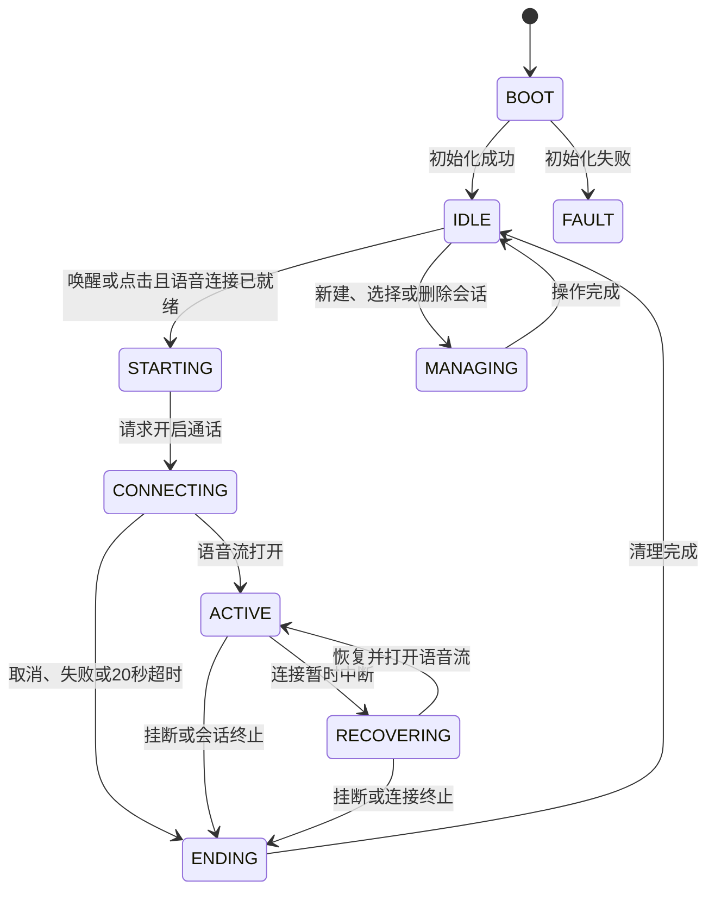

# A / Orbit：状态与代码结构

## 职责

```text
现有 voice.c：通话业务状态机、音频采集与网络恢复（本次未改）
     │ sugarat_voice_view() → screen_state_t.voice
     │ Wi-Fi → screen_state_t.wifi_connected / wifi_setup_active
     │ 现有 voice_playback_level() → 播放读数
     ▼
home_presenter.c：纯函数，将设备快照投影为 UI 快照，集中定义文案和按钮权限
     ▼
home_screen.c：A 方案控件、统一按钮、中央动效，只读快照，不操作音频或网络
     │ home_action_cb_t：按钮意图
     ▼
共享 screen.c：显示页面或返回现有 SCREEN_* 动作
     ▼
原有 main.c：执行发起/结束通话、配网等动作；AMOLED 分支按显示期限等待
```

- `home_presenter.h/.c`：全部设备状态映射、播放视觉选择、唯一按钮权限判断。
- `home_screen.h/.c`：不依赖 ESP-IDF 的 LVGL 组件；不会启动/停止麦克风、切换 AEC 或改变业务状态。
- `ui_theme.h`：颜色、字体、布局、触摸范围和动画节奏。
- `../screen_port.c`：PSRAM 全帧缓冲、异步传输、刷新期限及屏幕输入。
- `../frame_rotate.c`：按小块进行 RGB565 顺时针 90° 旋转和字节序转换，不修改 LVGL 的逻辑帧。
- 共享 `sugarat/main/screen.c` 只在此板编译时通过 `SUGARAT_NATIVE_AMOLED_UI` 选择 A 方案；其他板仍使用原有主屏。

## 现有业务状态机

业务状态仍由 `sugarat/components/sugarat_voice/voice.c` 管理，不在 UI 中复制。
内部有 9 个模式；它结合平台和网络状态，对外提供 16 个 `sugarat_voice_phase_t`。
内部 `IDLE` 仅表示没有进行中的通话，不等于已联网或已就绪。



## 16 个设备状态的显示映射

| 设备 phase | 主标题 | 中央视觉 | 主操作 |
| --- | --- | --- | --- |
| BOOT | Starting | 连接进度圆弧 | Waiting，禁用 |
| SETUP | Wi-Fi setup | 断开的圆环与 Wi-Fi 图标 | Wi-Fi；热点已开时禁用 |
| JOINING | Joining Wi-Fi | 连接进度圆弧 | Waiting，禁用 |
| PLATFORM_CONNECTING | Connecting | 连接进度圆弧 | Waiting，禁用 |
| PLATFORM_RETRYING | Offline | 断开的圆环与 Wi-Fi 图标 | Settings |
| ACTIVATE | Activate | 真实六位激活码 | Waiting，禁用 |
| BIND_AGENT | Choose agent | 静态圆环 | Waiting，禁用；提示在平台绑定 |
| PREPARING | Preparing | 连接进度圆弧 | Waiting，禁用 |
| READY | Ready | 静态圆环 | Start call |
| OPENING | Listening | 连接进度圆弧 | End call，受 can_end 控制 |
| IN_CALL | Listening | 麦克风波形；播放时为外扩圆波 | End call |
| RECONNECTING | 通话内为 Listening；空闲连接恢复为 Reconnecting | 连接进度圆弧 | 通话内 End call；空闲时 Settings |
| ENDING | Ending call | 连接进度圆弧 | Waiting，禁用 |
| ERROR | Voice error | 断开的圆环 | Settings，提示重启设备 |
| RETRY | Interrupted | 连接进度圆弧 | Settings |
| NO_SESSION | No session | 静态圆环 | Sessions |

所有按钮都由一个 `action_enabled()` 判定是否可用：触摸不可用时禁用；
开始通话须为 READY；结束通话须由现有 `can_end` 允许；
配网须无通话且热点尚未开启；打开会话列表须已绑定 Agent 且无通话。
主屏控件和点击分发都使用同一份判定结果，主应用仍保留原有业务保护。

## 通话、播放与开麦

IN_CALL 内部只有“输入波形/播放圆波”两种绘图选择，不新增业务状态。
两者主标题都是 **Listening**，提示都是 **Microphone is on**，主操作都是 **End call**。
播放检测使用已有 `voice_playback_level()`，不使用 AEC 设备中刻意固定为 false 的 `voice.speaking`。
麦克风音量仍来自现有 AEC 输出，0–100 读数仅在 UI 显示时映射为 0–20。

不根据静音推测“AI 思考”。PREPARING/连接圆弧仅代表连接准备。
播放、UI 状态切换、菜单导航都不改变麦克风或 AEC；保留现有 FD_LOW_COST 全双工采集。
现有重连期间仍读麦，但 RECOVERING 不将帧加入上行队列；本次不改变该业务行为。

## 显示和验收

- 主屏原生 466×466，纯黑；其他原有页面保持 360×360，居中于原生画布。
- 90° 顺时针旋转和触摸逆变换仍匹配，CO5300 的 2×2 刷新窗口保留边界像素。
- 动画和显示刷新统一为 33 ms，目标约 30 FPS；移除原来的 80 ms 动效节流。
  视觉变化集中于中央，离开主屏暂停动画，动效时长保持不变。
- LVGL 使用双缓冲 DIRECT 模式，两个 434312 字节逻辑帧和一个同样大小的旋转帧均放在 PSRAM，
  共 1302936 字节（约 1.24 MiB）。逻辑帧保留静态像素，只重绘和旋转变化的包围矩形，
  每次仍将完整旋转帧提交给屏幕；静态页面不强制重绘。
- 低优先级传输任务负责旋转和 QSPI，LVGL 可以同时绘制下一帧。
  多个失效区域在最后一个 flush 合并成一次整帧发送。传输任务不调用 LVGL；
  完成旋转后即释放逻辑帧，UI 的 flush-wait 回调等待此信号，避免忙等和过早复用帧。
  SPI 始终读取独立的物理帧，单个传输任务在发送结束后才处理下一帧。
- UI 使用 LVGL 给出的下一次处理时间和 ESP 高精度定时器唤醒；定时器回调只发送任务通知，
  所有 LVGL 操作仍在原 UI 任务中。保留 100 Hz 系统 tick 和原有音频任务调度。
- 旋转后的整帧按 32 行连续传输，一帧 15 个窗口；内部 DMA 暂存区为 29824 字节。
  每个窗口的列、行、像素三个描述符一次入队，驱动持有描述符和像素副本直到 DMA 归还所有权；
  保留 40 MHz QSPI，未将普通 PSRAM 指针直接交给 DMA。
- LVGL 和此板显示代码单独使用 `-O2`，音频代码的编译配置不变。
- 启用 PSRAM XIP，将 Flash 中的程序和只读资源在启动时搬入 PSRAM；
  指令缓存为 32 KiB，数据缓存为 64 KiB、64 字节缓存行，三个帧的起始地址均按 64 字节对齐。
  这会另外占用 PSRAM，并比默认缓存配置少 48 KiB 内部堆空间；运行日志报告两类剩余内存。
  配置依据 [乐鑫 LVGL PSRAM 优化建议](https://components.espressif.com/components/espressif/esp_lvgl_adapter/versions/0.8.0/readme#recommended-sdkconfig-settings)，未引入该适配器或替换项目 LVGL 版本。
- 每 5 秒输出 `amoled_display: refresh`，记录完成传输的实际 FPS、绘制/旋转/传输耗时、
  窗口数、错误数和剩余内存；`target_ms=33` 是目标周期，不代表测得 30 FPS。
  静态待机接近 0 属于正常省刷新；观察稳定动效期间的数据。
  `avg_prepare_us` 包含绘制和等待前一帧传输完成的时间，不能作为纯 CPU 绘制耗时。
- 播放切换的文字、提示和按钮保持相同；原生渲染验证只有中央像素变化，物理传输为全帧。
- 没有真实电量接口时隐藏电量，正式固件不显示预览的 74%。
- `ui-preview/render.ps1` 使用实际 `home_presenter.c` 和 `home_screen.c`，模拟现有设备快照，
  渲染全部 16 个 phase，检查按钮保护、原生尺寸、圆屏边缘和全帧刷新下的视觉一致性。
- `tests/run-host-tests.ps1` 验证全部 217156 个显示/触摸位置、分块旋转、双缓冲所有权和完成信号、
  15 窗口传输、QSPI 超时恢复、小于一个系统 tick 的 UI 唤醒，以及既有持续采集与 AEC 调度。

原生 PNG、播放动效和检查结果在 `ui-preview/renders/device-states/`。
设备上的触摸手感、声学回声消除和实际功耗仍需实机验收。
